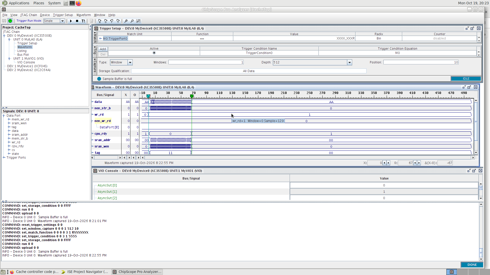
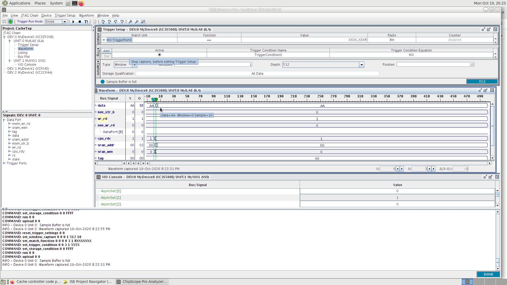
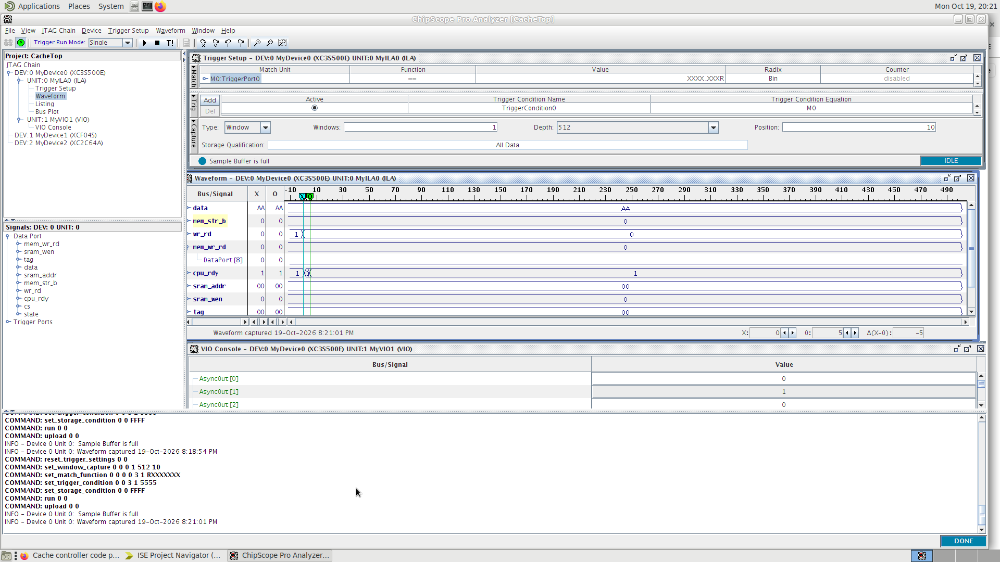
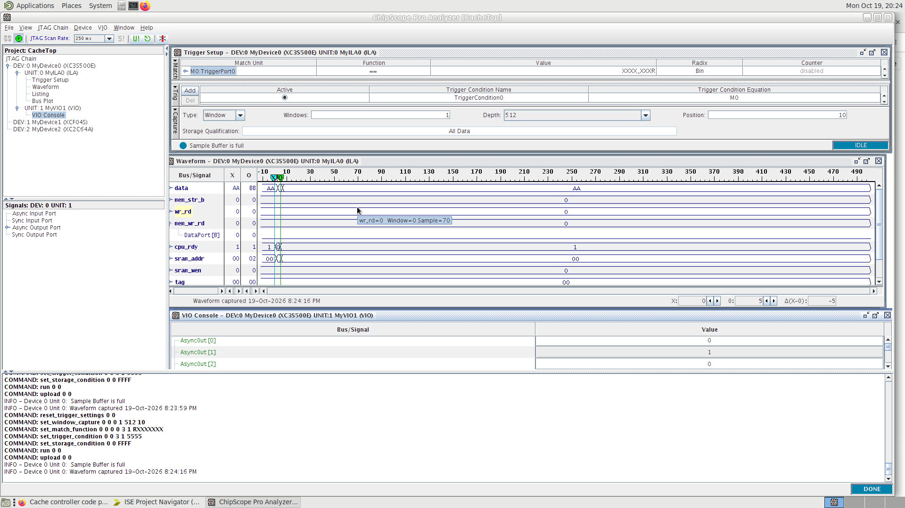
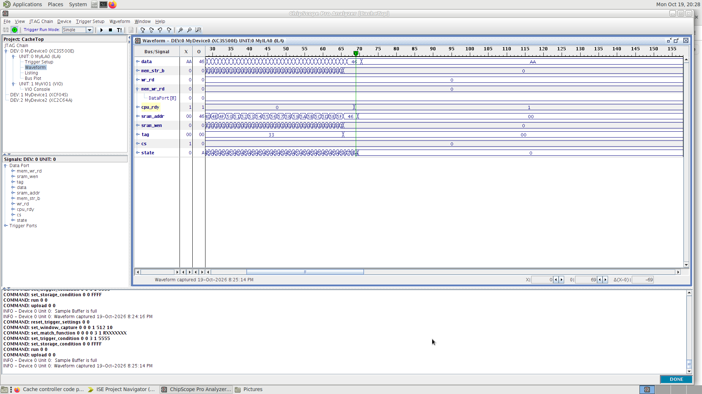
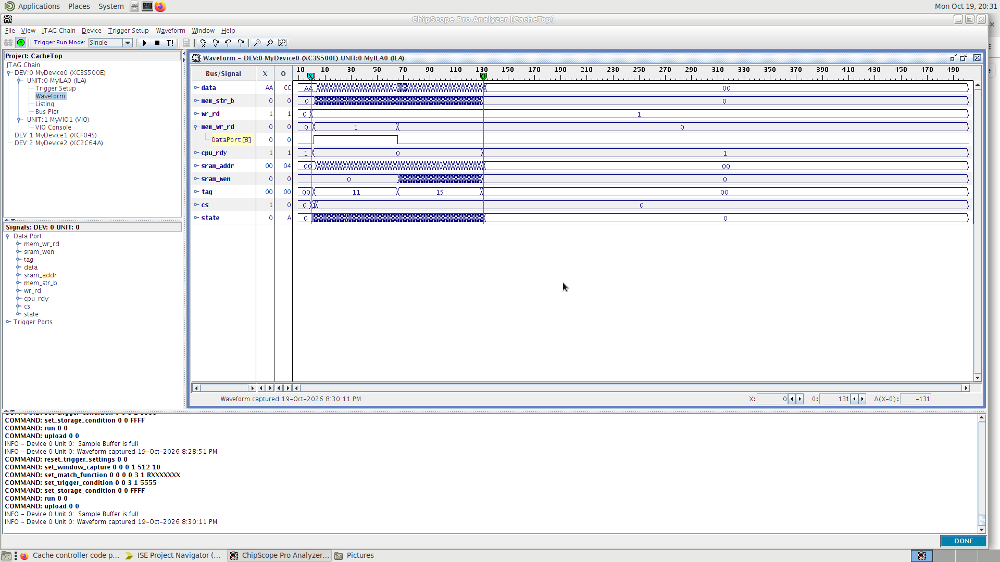

# Cache Controller (VHDL, Spartan-3E)

A direct-mapped cache controller written in VHDL for COE758 (Digital Systems Engineering) at Toronto Metropolitan University. It sits between a CPU and main memory, decides on every request whether it is a hit or a miss, and moves whole blocks to and from memory when needed. Tested in simulation (ISim) and on a Xilinx Spartan-3E FPGA using ChipScope.

## Cache organization

- 256-byte cache: 8 blocks × 32 bytes, stored in a Block RAM
- 16-bit CPU address, split into:

| Tag (15–8) | Index (7–5) | Offset (4–0) |
|---|---|---|
| which memory block | which cache block | which byte in the block |

- Each block keeps a **tag**, a **valid bit** and a **dirty bit**
- Write-back policy: a changed (dirty) block is only written to memory when it gets replaced

## The 4 cases

| Case | Situation | What the controller does |
|---|---|---|
| 1 | Write hit | Write the byte into the cache, set dirty = 1 |
| 2 | Read hit | Read the byte from the cache, send it to the CPU |
| 3 | Miss, dirty = 0 | Fetch the 32-byte block from memory, then do the read/write |
| 4 | Miss, dirty = 1 | Write the old block back to memory, fetch the new block, then do the read/write |

## Files

| File | What it is |
|---|---|
| `CacheController.vhd` | The controller FSM (hit/miss check, write-back, fetch, read, write) |
| `CacheSystem.vhd` | Wires the CPU, controller, cache BRAM and data muxes together |
| `CPU_gen.vhd` | CPU test generator (given by the course); sends 8 fixed requests |
| `SDRAM_model.vhd` | 2 KB on-chip Block RAM used as main memory on the board |
| `CacheTop.vhd` | Hardware top level with ChipScope ICON, ILA (capture) and VIO (rst/trig) |
| `CacheTop.ucf` | Clock pin: 50 MHz oscillator on C9 |
| `CacheSystem_tb.vhd` | Testbench: runs all 8 requests, checks read data and write-backs |
| `ipcore_dir/` | Core settings for `bram`, `icon`, `ila`, `vio` |

## Controller states

| # | State | # | State |
|---|---|---|---|
| 0 | IDLE | 6 | READ_SETUP |
| 1 | CHECK | 7 | READ_WAIT |
| 2 | WB_SETUP | 8 | COMPLETE_READ |
| 3 | WB_STROBE | 9 | COMPLETE_WRITE |
| 4 | FETCH_SETUP | 10 | WAIT_RELEASE |
| 5 | FETCH_STROBE | | |

Memory transfers take 2 clocks per byte (set address, then strobe), so one block is 64 clocks.

## Test sequence

| # | CPU request | Result |
|---|---|---|
| 1 | Write AA to 0x1100 | Case 3: clean miss |
| 2 | Write BB to 0x1102 | Case 1: write hit |
| 3 | Read 0x1100 | Case 2: read hit, returns AA |
| 4 | Read 0x1102 | Case 2: read hit, returns BB |
| 5 | Read 0x3346 | Case 3: clean miss, returns 46 |
| 6 | Read 0x4444 | Case 3: clean miss, returns 44 |
| 7 | Write CC to 0x5504 | Case 4: dirty miss (writes back block 0x1100) |
| 8 | Read 0x6606 | Case 4: dirty miss, returns 06 |

## Results (measured on hardware, 50 MHz clock = 20 ns per cycle)

Measured from `cs` going high to `cpu_rdy` going high.

| N | Cache performance parameter | Cycles | Time (ns) |
|---|---|---|---|
| 1 | Hit/miss determination time | 2 | 40 |
| 2 | Data access time | 1 (write) / 3 (read) | 20 / 60 |
| 3 | Block replacement time | 64 | 1280 |
| 4 | Hit time: Case 1 / Case 2 | 3 / 5 | 60 / 100 |
| 5 | Miss penalty, Case 3 (D = 0) | 67 | 1340 |
| 6 | Miss penalty, Case 4 (D = 1) | 131 | 2620 |

## ChipScope waveforms

**T1: write miss, dirty = 0 (Case 3), 67 cycles**

**T2: write hit (Case 1), 3 cycles**

**T3: read hit (Case 2), 5 cycles, returns AA**

**T4: read hit (Case 2), 5 cycles, returns BB**

**T5: read miss, dirty = 0 (Case 3), 69 cycles, returns 46**

**T7: write miss, dirty = 1 (Case 4), 131 cycles**: write-back of the old block (tag 0x11), then fetch of the new block (tag 0x55)

## How to run

**Simulation:** in ISE, select `CacheSystem_tb` in Simulation view, run *Simulate Behavioral Model*, then `run 20 us`. All 8 transactions should complete with no errors.

**Hardware:**
1. Set `CacheTop` as the top module (make sure `CacheTop.ucf` is under it) and *Generate Programming File*
2. In ChipScope, open the JTAG chain and configure the FPGA with `CacheTop.bit`
3. ILA trigger: TRIG0 bit 0 (`cs`) rising edge
4. VIO `AsyncOut[0]` = rst (pulse 1 → 0 once), `AsyncOut[1]` = trig (1 → 0 for each request)
5. Arm the ILA (▶) before each trig

## Authors

Taha Syed and Anoosh Zaidi
